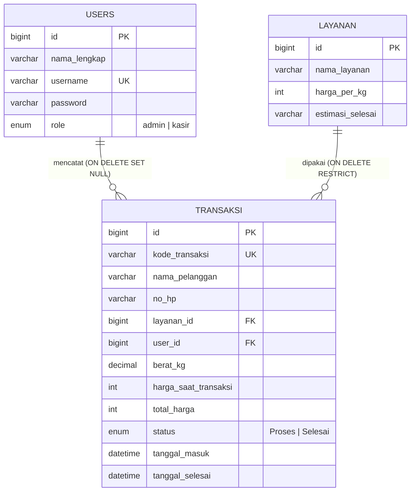

# ASAS Laundry — Sistem Informasi Manajemen Laundry Berbasis Web (Laravel)

Aplikasi web **Sistem Informasi Manajemen Laundry** yang dibangun menggunakan **Laravel 13** dan **MySQL/MariaDB** untuk membantu pemilik usaha serta kasir mengelola paket layanan cuci, pencatatan transaksi pelanggan, pembaruan status pengerjaan (`Proses` → `Selesai`), cetak struk resmi, hingga rekap laporan keuangan berbasis relasi database.

- **Repository GitHub:** [https://github.com/Kuronami089/ASAS_Laundry](https://github.com/Kuronami089/ASAS_Laundry)
- **Live Demo (GitHub Pages):** [https://kuronami089.github.io/ASAS_Laundry/](https://kuronami089.github.io/ASAS_Laundry/)

> **Catatan Hosting GitHub Pages:** GitHub Pages hanya melayani file statis (HTML, CSS, dan JavaScript) dan tidak menjalankan server PHP/MySQL. Oleh karena itu, tautan Live Demo di atas menjalankan **versi demo interaktif statis (`docs/`)** berbasis `localStorage` dengan tampilan dan alur yang identik, sedangkan **kode backend penuh Laravel 13 + MySQL** berada di root repository ini dan dapat dijalankan secara lokal maupun di server hosting PHP (mis. Laravel Cloud, Railway, VPS, atau cPanel).

---

## Fitur Utama

### 1. Autentikasi & Pembatasan Hak Akses Berbasis Role (`Admin` & `Kasir`)
- Halaman login full-screen editorial dengan foto studio laundry, panel kaca buram (*frosted glass*) terpisah garis vertikal, logo kustom **ASAS Laundry**, serta efek tipografi organik **Lora** + **Black Ink Bleed** (SVG filter `feTurbulence`, `feDisplacementMap`, `feGaussianBlur`, dan `feComponentTransfer`).
- Sistem autentikasi Laravel (`Auth::attempt`, hash password `bcrypt`, proteksi CSRF, dan regenerasi session).
- **Middleware `role:admin`** ([RoleMiddleware.php](app/Http/Middleware/RoleMiddleware.php)) membatasi akses:
  - **Admin (`Faqih Rachman`)**: Akses penuh ke Dashboard, CRUD Data Layanan, Transaksi Laundry, Rekap Transaksi, Cetak Struk, dan Hapus Pesanan.
  - **Kasir (`Nadia Putri`)**: Fokus operasional pada Dashboard, Transaksi Laundry, Rekap Transaksi, Cetak Struk, dan Hapus Pesanan (akses ke `/layanan` otomatis diblokir).

### 2. Dashboard Operasional
- Menampilkan 4 metrik nyata langsung dari database: **Total Transaksi**, **Sedang Diproses**, **Transaksi Selesai**, dan **Total Pendapatan (`Rp`)**.
- Menampilkan panel referensi **Tarif Layanan Aktif** dan tabel **Antrean Cucian dalam Proses** dengan tombol aksi cepat **Tandai selesai**.

### 3. CRUD Data Layanan & Proteksi Relasi Foreign Key (Khusus Admin)
- Tambah, lihat, ubah, dan hapus paket layanan cuci dengan data awal sesuai spesifikasi:
  - **Reguler** — Rp 7.000/kg (`3-4 hari`)
  - **Ekspres** — Rp 12.000/kg (`1-2 hari`)
  - **Superkilat** — Rp 25.000/kg (`5 jam`)
- Validasi sisi klien dan server menolak harga kosong, `0`, atau bernilai negatif.
- Penghapusan layanan memakai modal konfirmasi native `<dialog>` dan **proteksi relasi 2 lapis** (pengecekan jumlah transaksi terkait di `LayananController` + constraint `ON DELETE RESTRICT` di MySQL) agar layanan yang masih digunakan transaksi tidak dapat dihapus dan laporan keuangan tetap utuh.

### 4. Transaksi Laundry & Kalkulasi Tarif Otomatis
- Form pencatatan order baru (nama pelanggan, nomor HP, pilihan jenis layanan dari database, dan berat cucian dalam `kg`).
- Perhitungan total biaya otomatis menggunakan rumus `berat_kg × harga_per_kg` dalam format Rupiah (`Rp`) secara langsung di antarmuka dan dihitung ulang secara resmi di server (`TransaksiController`) saat disimpan.
- Status awal transaksi otomatis terisi **`Proses`**, lalu dapat diperbarui menjadi **`Selesai`** lengkap dengan stempel waktu `tanggal_selesai`.

### 5. Rekap Transaksi Laundry, Filter Laporan, Cetak Struk & Hapus Pesanan
- Query relasional **`SQL INNER JOIN`** antara tabel `transaksi`, `layanan`, dan `LEFT JOIN` ke `users` di [RekapController.php](app/Http/Controllers/RekapController.php) untuk menampilkan laporan dan total pendapatan secara akurat.
- Pengelompokan otomatis yang rapi agar tidak perlu scroll panjang saat data banyak: mode **Per Status** (`Sedang diproses` / `Transaksi selesai`), **Per Layanan**, **Per Tanggal** (dengan accordion `<details>`, subtotal per grup, dan tombol *Buka semua / Lipat semua*), serta mode **Per Halaman (5 baris)** dengan pagination.
- Filter berbasis URL (`?q=`, `?status=`, `?layanan_id=`, `?group=`) untuk pencarian pelanggan/kode transaksi, filter status (`Proses`/`Selesai`), dan filter jenis layanan.
- Badge status berbeda warna dengan ikon SVG aksesibel: **kuning** untuk `Proses` dan **hijau** untuk `Selesai`.
- Dilengkapi **ikon struk** pada setiap baris untuk membuka halaman struk resmi siap cetak (`/rekap/{transaksi}/struk`) serta **ikon tempat sampah** dengan modal konfirmasi `<dialog>` untuk menghapus pesanan terpilih.

---

## Skema Database & Relasi

Aplikasi menggunakan 3 tabel utama di database MySQL `db_laundry` (dikelola melalui Laravel Migrations dan juga didokumentasikan pada [database.sql](database.sql)):



---

## Struktur Proyek Laravel

```text
ASAS_Laundry/
├── app/
│   ├── Http/
│   │   ├── Controllers/
│   │   │   ├── AuthController.php        # Login, validasi akun, dan Logout
│   │   │   ├── DashboardController.php   # Statistik DB & antrean Proses
│   │   │   ├── LayananController.php     # CRUD Data Layanan + proteksi FK
│   │   │   ├── TransaksiController.php   # Input order, kalkulasi tarif, status Selesai, hapus
│   │   │   └── RekapController.php       # Rekap SQL JOIN, filter URL, & cetak struk
│   │   └── Middleware/
│   │       └── RoleMiddleware.php        # Pembatasan akses halaman berdasarkan role
│   ├── Models/
│   │   ├── User.php                      # Relasi hasMany(Transaksi) & isAdmin()
│   │   ├── Layanan.php                   # Relasi hasMany(Transaksi)
│   │   └── Transaksi.php                 # Relasi belongsTo(Layanan, User) & generateKode()
│   └── Support/
│       └── FormatHelper.php              # Format Rupiah, berat (kg), dan tanggal Indonesia
├── database/
│   ├── migrations/                       # Skema users, layanan, transaksi + Foreign Key
│   └── seeders/
│       └── DatabaseSeeder.php            # Seed Admin, Kasir, 3 layanan, & 14 transaksi awal
├── docs/                                 # Demo statis interaktif untuk GitHub Pages
├── public/assets/
│   ├── css/                              # tokens.css, base.css, app.css (desain sistem Dose)
│   ├── img/                              # Logo kustom SVG & foto editorial login
│   └── js/app.js                         # Ink Bleed, kalkulator tarif, modal dialog, drawer
├── resources/views/
│   ├── layouts/app.blade.php             # Layout sidebar desktop + mobile drawer responsif
│   ├── auth/login.blade.php              # Halaman login full-screen + frosted panel
│   ├── dashboard/index.blade.php         # Halaman dashboard
│   ├── layanan/index.blade.php           # Halaman CRUD Data Layanan
│   ├── transaksi/index.blade.php         # Halaman Transaksi Laundry
│   └── rekap/
│       ├── index.blade.php               # Halaman Rekap Transaksi Laundry
│       └── struk.blade.php               # Halaman Cetak Struk
├── routes/web.php                        # Daftar route web aplikasi
├── tests/Feature/LaundryFlowTest.php     # Pengujian otomatis PHPUnit
└── database.sql                          # Salinan skema SQL mentah MySQL/MariaDB
```

---

## Cara Instalasi & Menjalankan Lokal (Laravel + MySQL)

### Prasyarat
- PHP `>= 8.2` (diuji pada PHP 8.5) dengan ekstensi `pdo_mysql`, `mbstring`, `openssl`, `fileinfo`
- Composer `>= 2.x`
- MySQL / MariaDB (XAMPP atau Laragon)

### Langkah Menjalankan
1. **Clone repository:**
   ```bash
   git clone https://github.com/Kuronami089/ASAS_Laundry.git
   cd ASAS_Laundry
   ```
2. **Instal dependensi PHP:**
   ```bash
   composer install
   ```
3. **Konfigurasi file `.env`:**
   ```bash
   cp .env.example .env
   php artisan key:generate
   ```
   Sesuaikan koneksi database MySQL pada `.env`:
   ```env
   DB_CONNECTION=mysql
   DB_HOST=127.0.0.1
   DB_PORT=3306
   DB_DATABASE=db_laundry
   DB_USERNAME=root
   DB_PASSWORD=
   ```
4. **Buat database `db_laundry` di MySQL/phpMyAdmin**, lalu jalankan migrasi dan seeder:
   ```bash
   php artisan migrate:fresh --seed
   ```
5. **Jalankan server pengembangan Laravel:**
   ```bash
   php artisan serve --host=127.0.0.1 --port=8088
   ```
   Buka browser di `http://127.0.0.1:8088`.

---

## Akun Login Default

| Role | Nama Petugas | Username | Kata Sandi | Hak Akses |
| :--- | :--- | :--- | :--- | :--- |
| **Admin** | Faqih Rachman | `admin` | `admin123` | Penuh (Dashboard, CRUD Data Layanan, Transaksi, Rekap, Struk, Hapus) |
| **Kasir** | Nadia Putri | `kasir` | `kasir123` | Operasional (Dashboard, Transaksi, Rekap, Struk, Hapus; tanpa CRUD Layanan) |

---

## Pengujian Otomatis

Jalankan seluruh skenario pengujian fitur (login beda role, pembatasan akses Kasir, validasi harga negatif, CRUD layanan, proteksi Foreign Key, perhitungan tarif server, SQL JOIN rekap, cetak struk, dan hapus pesanan):

```bash
php artisan test
```
